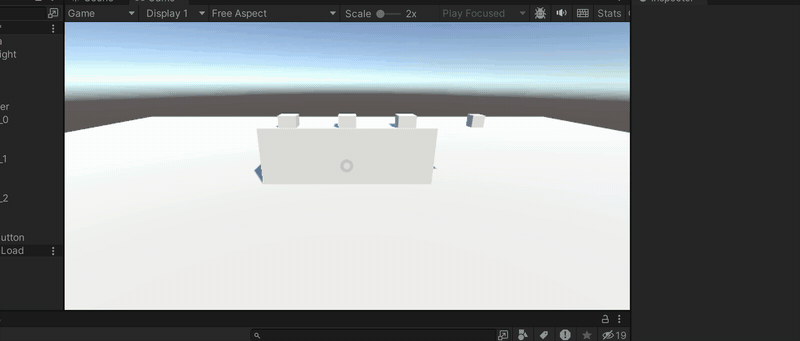

# Shout Bar: a synced button gimmick

English | [日本語](README.ja.md)

*Recorded in Unity's ClientSim (the tool that reproduces VRChat's behaviour inside the editor). Higher-quality version: [docs/demo.mp4](docs/demo.mp4). The particles look like pink squares because their material has not been set up yet.*

A "shout button" you place in a VRChat world. Press a button on the counter and a shout goes off — "Marx!", "Nietzsche!", "Freud!" — and everyone present sees the same sound, particle and popup effects at the same time. Press counts are shown on a scoreboard as totals and percentages, and people who join later see them too.

It is meant for anime watch parties and event bars, where everyone joins in with their own reactions.

> **Status (2026-10-21)**: compilation and button interaction / effects were confirmed in ClientSim with Unity 2022.3.22f1 (macOS, Intel build under Rosetta) and Worlds SDK 3.10.5. Multi-user syncing has **not been confirmed yet**. If you try it, please report the result in an Issue.

> **Want an AI to set it up for you?** Ask Claude Code, Codex or a similar agent to "read [`AGENTS.md`](AGENTS.md) and build a test world for the shout bar". It covers project creation through building the test scene on Windows, macOS and Linux (only the Unity and VRChat account steps are left to you).

## First: does it work in any world?

**No. It is a part that world *creators* build into their own worlds.**

- In VRChat, only the author of a world can change what is inside it. You cannot add these buttons to someone else's world afterwards.
- To use it, build your own world in Unity, incorporate this gimmick, and upload it to VRChat. The steps are in "For world creators: incorporating it" below.
- People who visit the finished world can press the buttons without setting anything up.

If you want to shout in *any* world, you need an avatar-side gimmick (sounds and effects triggered from the avatar menu). This repository is for worlds, not avatars.

## For players: how to use it

1. Join a world that has this gimmick installed.
2. Walk up to the counter buttons and click one (in VR, pull the trigger) while aiming at it. Each button shows its name, such as "Marx!".
3. Pressing it plays the effects for everyone there and increases the scoreboard numbers.
4. Even if you mash it, only one press per 0.5 seconds is counted.

## For world creators: incorporating it

### What you need
- A Windows PC (VRChat world creation uses Unity)
- [VRChat Creator Companion (VCC)](https://vrchat.com/home/download)
- A VRChat account (uploading worlds has requirements such as account trust level)
- VRChat Worlds SDK 3.8.1 or later (the gimmick uses parameterised network events)
- A TextMeshPro font that can render Japanese (built from something like Noto Sans JP)

### 1. Create the world project
1. Open VCC and create a project from the **Worlds** template via "Create New Project".
2. Check that the Worlds SDK is 3.8.1 or later (you can update it in VCC's "Manage Project").
3. Open the project in Unity with "Open Project".

### 2. Add the scripts
1. Copy the three `.cs` files from this repository's `Assets/Scripts/` into your Unity project's `Assets/Scripts/`.
2. In Unity's Project window, right-click each `.cs` → **Create → U# Script** to create the UdonSharp assets.

### 3. Build it
1. Create an empty GameObject named `ShoutManager`, add a Udon Behaviour component, and assign `ShoutManager` to it.
2. Place three button Cubes on the counter (each needs a Collider).
   - Add a Udon Behaviour to each and assign `ShoutButton`
   - Set `manager` to the ShoutManager above and `index` to 0 / 1 / 2
   - Set the Interaction Text to "Marx!", "Nietzsche!", "Freud!"
3. Prepare the effects and put them into the ShoutManager arrays in index order.
   - `sounds`: AudioSources (Play On Awake off)
   - `particles`: ParticleSystems (Play On Awake off)
   - `popups`: World Space Canvases carrying portraits or logos; an appear animation makes them stand out
4. Place a TextMeshPro object on a World Space Canvas and assign it to ShoutManager's `scoreText`.
5. Place a Cube somewhere staff-only, assign `ShoutResetButton`, and set its `manager` (to zero the counts between episodes).

### 4. Test it
1. In the VRChat SDK control panel, use "Build & Test" to start **two** clients.
2. Press a button in one and check that the effects appear in the other.
3. Leave one client and rejoin, and check that the counts show correctly for someone arriving mid-session.

### 5. Upload it
Upload the world from the VRChat SDK control panel's "Build & Upload". Publishing it as Private first, to try it with friends, is recommended.

## Customising

| What you want | How |
|---|---|
| Change or add the shouted names | Rewrite `shoutNames` on ShoutManager and provide the same number of buttons and effects (up to 8) |
| Change the mash limit | `cooldownSeconds` (default 0.5 s) |
| Popup display time | `popupSeconds` (default 2 s) |
| Let anyone reset | Turn `onlyMasterCanReset` off |
| Use it in another language (the text here is Japanese by default) | Rewrite `shoutNames`, each button's Interaction Text and the popup text (e.g. Marx / Nietzsche / Freud). English and other Latin-script text render with Unity's standard font, so no Japanese font is needed |

## How it works

- The person who presses a button asks the owner of the ShoutManager to increment the counts, and at the same time tells everyone to play the effects.
- The counts are synced variables, so late joiners see the totals too.
- If the owner leaves the world, VRChat automatically hands ownership to someone else.

## Cautions

- **Portraits and images**: use public-domain photos or your own artwork.
- **Showing video such as anime inside a world** can run into copyright problems. The intended use is that everyone watches on their own subscription and only the playback timing is matched.
- Follow VRChat's Terms of Service and Community Guidelines.

## License

MIT License ([LICENSE](LICENSE)). Use it, modify it, redistribute it — no warranty.
